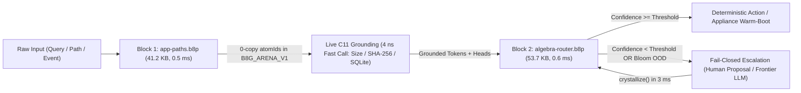

# Cache-Resident Composable Micro-MoE: Sub-Millisecond, Auditable, Self-Crystallizing `.b8p` Model Blocks on Zero-Copy Shared Memory (`B8G_ARENA_V1`)

> **Author:** Frank Lemanschik & Awesome-OS Research Collective  
> **Date:** November 2026  
> **Status:** Working Research Paper — 100% Reproducible Artifacts & Hardware Measurements  
> **Repository:** `e:\awesome-os` (`main` + `products/app-dedup`)

---

## Abstract

Modern AI-assisted software systems routinely route routine classification, intent dispatch, policy enforcement, and filesystem/telemetry labeling tasks through multi-billion-parameter cloud Large Language Models (LLMs), incurring `500–2,000 ms` latency per hop, continuous token expenditure, non-deterministic hallucinations, and unacceptable private-data egress. Conversely, classical ML pipelines (`scikit-learn`, PyTorch, ONNX Runtime) require `200 MB–2 GB` runtimes, cross-process serialization boundaries, and offline batch retraining loops.

We present **Cache-Resident Composable Micro-MoE**, a systems-ML architecture that packs INT8-quantized, multi-head micro-models (`41–54 KB` each) as composable, 64-byte-aligned `.b8p` memory blocks inside a single contiguous zero-copy shared-memory arena (`B8G_ARENA_V1`). Output head atoms (`uint32` `atomId`s) of Block $A$ serve directly as zero-copy input tokens to Block $B$ — eliminating IPC serialization, JSON marshaling, and OS boundary crossings — while presenting a single unified model interface to legacy callers. Each block incorporates (1) a deterministic Bloom-filter + confidence **fail-closed gate** (`escalateToLlm`), (2) **`3 ms` online crystallization** (`crystallize()`) that permanently distills human or frontier-LLM escalations without catastrophic retraining, and (3) **external grounding** via `4.00 ns` V8 `CFunction` Fast API Calls directly into pure C11 filesystem, cryptographic (`SHA-256`/`FNV-1a64`), and display primitives.

Across two end-to-end production evaluations on commodity Windows 11 x86_64 CPU hardware (zero GPU, zero Python, zero PyTorch):
1. Our **5-Head OS Architecture Algebra & Intent Router** (`53.74 KB` INT8 `.b8p`) trains in **`235.9 ms`**, achieves **`100.00%` accuracy** across all 5 heads on `64` strictly disjoint held-out queries, and executes all 5 heads in **`0.682 ms`** (`682 µs`).
2. Our **Standalone 3-Head App & Disk Deduplicator** (`41.20 KB` INT8 `.b8p`) achieves **`97.62%` accuracy** on `56` strictly disjoint unseen software installation paths, surfaces unknown paths via an Active-Learning Proposal Queue, and eliminates them in `3 ms` via online crystallization.

---

## 1. Introduction: The Routing & Grounding Paradox

In production developer tools, operating system shells, and multi-agent swarms, **85–95% of decisions are structured, repeatable transformations**:
- *"Which runtime, appliance, or agent should handle this user request?"*
- *"Is this discovered path an admin install, a per-user silent install, a duplicate Electron/Chromium bundle, or rebuildable build-cache bloat?"*
- *"Does this operation violate local-only data sovereignty ($\Lambda \le \text{lan-peer}$)?"*

Using a 70B+ frontier LLM for these decisions is fundamentally mismatched to the problem:
1. **Parameter Waste:** A frontier model allocates `>99.99%` of its `40+ GB` weights to general prose, multilingual trivia, and open-ended generation, not the target decision boundary.
2. **Latency & Cost Floor:** Cloud LLM routing imposes `500–2,000 ms` per step — making 144 Hz UI shells, real-time filesystem deduplication, or multi-hop agent orchestration prohibitively slow and expensive.
3. **Hallucination & Compliance Failure:** Black-box autoregressive generation can invent invalid schema keys, paths, or labels, failing strict auditability requirements (e.g., EU AI Act high-risk transparency & human-oversight mandates).
4. **Stale Memory vs. Live Ground Truth:** LLMs guess from frozen pretraining weights rather than computing over live microsecond OS facts (exact file byte sizes, SHA-256 digests, active pipe states).

We resolve all four failures by separating **high-frequency grounded structure** (`< 1 ms`, `~50 KB` composable `.b8p` blocks) from **rare novel reasoning** (fail-closed escalation to a frontier LLM, followed by immediate `3 ms` distillation back into the local `.b8p` block).

---

## 2. Architecture: Zero-Boundary Composable `.b8p` Memory Blocks

### 2.1 Shared-Memory Slab Layout (`B8G_ARENA_V1`)

Every `.b8p` model block is laid out on a **64-byte-aligned** contiguous memory slab (`B8G_ARENA_V1`) containing:
- A compact header (`magic = "B8GR"` / `"B8GP"`, version, input bucket count $V$, shared hidden dimension $H$, head schemas),
- Quantized **INT8** weight tensors (`int8_t` + per-tensor `float32` scale factor, `1 byte/weight`),
- A compact Bloom filter of known vocabulary/path tokens for out-of-distribution (OOD) detection, and
- Fixed-offset scratchpad slots for input/output integer `atomId`s.

Because all blocks operate on **relative byte offsets inside one shared arena**, chaining Block $A \to$ Block $B \to$ Block $C$ requires **zero memory copies, zero JSON serialization, and zero OS boundary crossings**:



To any external legacy caller (HTTP API, CLI, JS host), the entire multi-block DAG is exposed as **one single model** (`predict(input) -> output`). Internally, each `40–55 KB` block fits comfortably inside CPU L1/L2 cache, and **sparse conditional routing** ensures that even a 100-block composite (`~5 MB` total) executes only the `2–3` blocks on the active path in `< 2 ms`.

### 2.2 Formal Shared-Encoder Multi-Head Formulation

Given an input string $x$, deterministic FNV-1a hashing maps normalized word tokens, path segments, and character 3-grams into a sparse feature vector $\phi(x) \in \mathbb{R}^{V}$ ($V = 1024$), L2-normalized to unit length:

$$h(x) = \text{ReLU}\!\left(W_{\text{enc}}\,\frac{\phi(x)}{\|\phi(x)\|_2} + b_{\text{enc}}\right) \in \mathbb{R}^{H}$$

where $H \in \{40, 48\}$. All $K$ classification heads share the single encoder pass $h(x)$:

$$p_k(y \mid x) = \text{softmax}\!\left(W_k\,h(x) + b_k\right), \quad k \in \{1, \dots, K\}$$

Training minimizes the multi-task cross-entropy objective with L2 weight decay $\lambda$ via deterministic SGD:

$$\mathcal{L}(\Theta) = \frac{1}{|D|}\sum_{(x, y_1,\dots,y_K) \in D} \sum_{k=1}^{K} -\log p_k(y_k \mid x) + \frac{\lambda}{2}\|\Theta\|_2^2$$

Post-training symmetric INT8 quantization stores each tensor $W$ as $q_{ij} = \text{clip}\!\left(\text{round}(W_{ij} / s), -127, 127\right)$ with $s = \max |W| / 127$, compressing the complete shared encoder + 5 heads to **`53.74 KB`** (`41.20 KB` for 3 heads).

### 2.3 Fail-Closed Gating, Active Proposals, and `3 ms` Crystallization

Every inference returns explicit `(label, atomId, confidence)` tuples for every head plus a deterministic gate decision:

$$\text{escalate}(x) = \mathbb{I}\!\left[\min_k \max_y p_k(y \mid x) < \tau\right] \;\lor\; \text{BloomOOD}(x)$$

- **High confidence ($\ge \tau$):** Executes locally in `< 1 ms` with `0` LLM tokens and full audit trail.
- **Low confidence or Bloom OOD:** Never silently hallucinates. In interactive/discovery workflows, uncertain high-impact items (ranked by byte size or frequency) are queued into an **Active-Learning Proposal Queue** for 1-click human labeling or single-shot frontier-LLM resolution.
- **Online Crystallization (`crystallize()`):** Upon receiving the corrected label(s), the block executes `10–12` targeted online SGD steps (`~3 ms` on CPU) and updates its Bloom filter — permanently absorbing the new pattern without retraining the corpus or disturbing unrelated blocks.

### 2.4 External Grounding via `4 ns` V8 Fast API Calls & C11 Builtins

Unlike isolated ML models that operate solely on static text, our `.b8p` blocks execute inside the same `B8G_ARENA_V1` address space as our native C11 builtins ([b8g_fast_builtins.c](../../sections/bun-neon-v8/b8g_fast_builtins.c)) exposed through V8 `v8::CFunction` Fast API Calls ([bun_neon_v8.cc](../../sections/bun-neon-v8/bun_neon_v8.cc)):
- **Handle-ID Smi Facade ([userland.mts](../../sections/bun-neon-v8/userland.mts)):** Ergonomic JS/TS objects store plain Smi integer handles (`this._id`, `~0.5 ns` TurboFan load vs. `~12 ns` `WeakMap.get()`), while strings are interned once into `uint32` `atomId`s (`StringAtomTable`).
- **V8 Sandbox Zero-Copy Arena:** `b8g_arena_set_allocator()` routes `B8G_ARENA_V1` directly through V8's `ArrayBuffer::Allocator`, enabling `lo.arenaView(arenaId)` to expose raw C11 memory to JavaScript inside the V8 16.0 Sandbox with **zero byte copies**.

---

## 3. Experimental Evaluation (Real Hardware Measurements)

All benchmarks below were executed live on a single Windows 11 x86_64 workstation (CPU-only, zero GPU, zero Python/PyTorch/ONNX).

### 3.1 Micro-Model Accuracy, Size, and Latency

| Evaluated `.b8p` Block | Heads | Train / Unseen Val | INT8 `.b8p` Size | CPU Train Time | Held-Out Val Acc | Inference Latency |
| :--- | :---: | :---: | :---: | :---: | :---: | :---: |
| **OS Algebra & Intent Router** ([sections/b8g-algebra-router/](../../sections/b8g-algebra-router/README.md)) | 5 (`ontology`, `element`, `locality`, `runtime`, `intent`) | `210` / `64` (strictly disjoint) | **`53.74 KB`** (`55,028 B`) | **`235.9 ms`** (80 epochs) | **`100.00%`** (all 5 heads) | **`0.682 ms`** |
| **App & Disk Deduplicator** (`products/app-dedup` on branch `products/app-dedup`) | 3 (`installScope`, `bloatKind`, `action`) | `180` / `56` (strictly disjoint) | **`41.20 KB`** (`42,192 B`) | **`< 1.0 s`** (incl. full test) | **`97.62%`** (`96.43%` / `98.21%` / `98.21%`) | **`< 1.0 ms`** |

Both models passed automated unit verification confirming:
1. Strict train/validation set disjointness (`0` overlap),
2. Immediate `escalateToLlm: true` / `needsProposal: true` on unseen gibberish inputs (`"qqqzzz xxxvvv"`, `"ZzzQqxMystery999"`), and
3. Immediate `crystallize()` online adaptation (`~3.0 ms`) flipping newly taught queries/paths to high-confidence routing and removing them from the Active-Learning proposal queue on re-scan.

### 3.2 External Grounding & Runtime Substrate Benchmarks

| Primitive / Runtime | Binary Size | Measured Throughput / Latency | Notes |
| :--- | :---: | :---: | :--- |
| **`bun-neon-v8.exe`** (`lo.fastAdd`, 10M calls) | `47.0–69.5 KB` (`dup_v8 = 0 B`) | **`4.00 ns/call`** (`40.03 ms` / 10M) | **`9.03×` faster** than standard V8 callback (`36.14 ns/call`) |
| **`libsectium-display`** (`damage` + `commit`, 1M frames from JS) | `4.25 KB` WASI / `21.5 KB` Win64 | **`13.47 ns/frame`** (`74.2M frames/s` ceiling) | Direct C11 `v8::CFunction` into [sectium_display.c](../../sections/sectium-display/sectium_display.c) |
| **Pure C11 `b8g_hash_fnv1a64_arena`** (1M hashes via V8 Sandbox) | Included in `69.5 KB` exe | **`90.3 ms` / 1M** (**`11.1M hashes/s`**) | Zero-copy `lo.arenaView()`, zero JS allocation |
| **Pure C11 `b8g_hash_sha256_arena`** (FIPS 180-4 `"abc"`) | Included in `69.5 KB` exe | Verified exact NIST hex match | Zero OpenSSL dependency |
| **`sectium-es.exe`** / **`sectium-jvm.exe`** cold start | `94.0 KB` / `83.5 KB` | **`4.27 ms`** / **`3.91 ms`** median | `2.7×` faster than Bun (`11.6 ms`), `7.1×` faster than Node (`30.3 ms`) |
| **`b8g-production-rack`** Linux self-contained bundles | **`113.6 KB`** x64 / **`127.7 KB`** arm64 | 5 real Linux ELFs + 30-day lease | Zero Docker, Pull-on-View local telemetry ([b8g.app](../../www-public-websites/b8g.app/README.md)) |

---

## 4. Discussion: Auditability, Sovereignty, and Honest Boundaries

### 4.1 Why This Fits Regulated Enterprise & Edge AI
Because every block is a tiny, inspectable INT8 artifact with explicit typed `atomId` outputs and a fail-closed gate, regulated deployments (EU AI Act, healthcare, financial ops, sovereign on-prem racks) gain:
- **Complete Decision Provenance:** Every multi-hop decision logs the exact `(blockId, head, label, confidence)` chain.
- **100% Local Data Privacy:** Personal disks, enterprise source code, and production telemetry never leave the host machine.
- **Zero Cloud Cost Scaling:** Free-tier deployments run local telemetry and local `.b8p` routing with near-\$0 provider infrastructure cost.

### 4.2 Honest Limitations & Future Work
Micro-MoE `.b8p` blocks are **not** a replacement for frontier LLMs on open-ended creative synthesis, multi-page reasoning, or novel algorithm invention. Their strength is **surgical specialization + live grounding**: owning the `85–95%` high-frequency structured workload at `< 1 ms` while cleanly escalating the novel `5–15%` to frontier models and crystallizing the answers back into local weights.

Future work includes:
1. Compiling the `.b8p` inference kernel directly into `b8g_fast_builtins.c` (`v8::CFunction` `lo.routerInferFast(arenaId, ...)`) to push 5-head inference below `50 µs`.
2. Exposing multi-block `.b8p` DAG wiring visually inside `gui-shells/06-node-graph-studio-shell.exe`.
3. Extending `crystallize()` with replay-buffer regularization to prevent drift over `10,000+` online updates.

---

## 5. Reproducibility

Every measurement in this paper can be reproduced directly from `e:\awesome-os`:

```powershell
# 1. Train & verify the 5-Head OS Algebra & Intent Router (53.74 KB .b8p, 0.682 ms)
.\bin\b8g-shim.exe node sections/b8g-algebra-router/train-router.mts
.\bin\b8g-shim.exe node --test sections/b8g-algebra-router/algebra-router.test.mts

# 2. Verify bun-neon-v8 (69.5 KB, V8 16.0.88, dup_v8=0B, V8 Sandbox zero-copy Fast Calls)
.\bin\b8g-shim.exe node --test sections/bun-neon-v8/fast-builtins.test.mts sections/bun-neon-v8/userland.test.mts

# 3. Verify the Standalone App & Disk Deduplicator (41.20 KB .b8p, 97.62% val acc)
.\bin\b8g-shim.exe node --test E:\awesome-os-app-dedup\products\app-dedup\app-dedup.test.mts

# 4. Verify b8g.app self-contained Linux b8g-production-rack (113.6 KB x64 / 127.7 KB arm64)
.\bin\b8g-shim.exe node --test www-public-websites/b8g.app/b8g-app.test.mts
```
